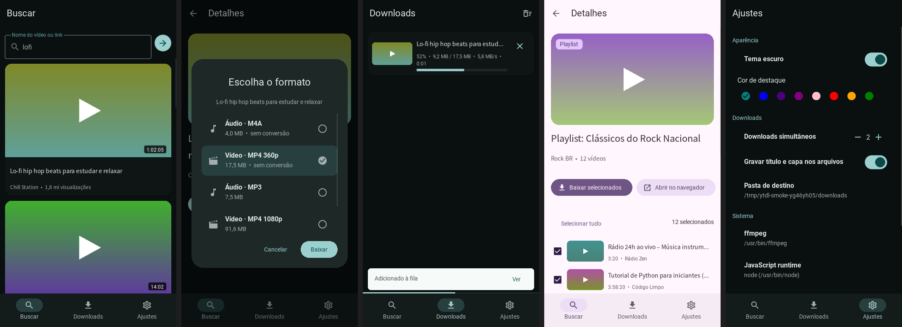

# YTDL — baixador de vídeo e áudio multiplataforma

Aplicativo com interface **Kivy + KivyMD** (Material 3) para buscar e baixar vídeos e músicas.
Roda em **Linux**, **Windows** (10/11 e, com limitações, 7) e **Android** (APK), a partir do mesmo código.



*Resultados da busca · escolha de formato · downloads com progresso real · playlist com seleção · ajustes.
Capturas geradas automaticamente em modo `--demo`; veja todas em [`demo/screenshots/`](demo/screenshots).*

> **Uso responsável.** Baixe apenas conteúdo que você tem direito de baixar. Respeite os termos de uso dos
> sites e as leis de direitos autorais do seu país. O projeto não contorna DRM.

---

## Sumário

1. [O que mudou em relação ao projeto original](#1-o-que-mudou-em-relação-ao-projeto-original)
2. [Recursos](#2-recursos)
3. [Versão do Python](#3-versão-do-python)
4. [Instalação para desenvolvimento](#4-instalação-para-desenvolvimento)
5. [Dependências opcionais: ffmpeg e runtime JavaScript](#5-dependências-opcionais-ffmpeg-e-runtime-javascript)
6. [Construção (build)](#6-construção-build)
   - [6.1 Linux e Windows 10/11 — PyInstaller](#61-linux-e-windows-1011--pyinstaller)
   - [6.2 Windows 7 (perfil legado)](#62-windows-7-perfil-legado)
   - [6.3 Android — Buildozer](#63-android--buildozer)
   - [6.4 Android no Windows (via WSL2)](#64-android-no-windows-via-wsl2)
7. [Estrutura do projeto e arquitetura](#7-estrutura-do-projeto-e-arquitetura)
8. [Logs e depuração](#8-logs-e-depuração)
9. [Configurações avançadas](#9-configurações-avançadas)
10. [Testes e o que foi verificado](#10-testes-e-o-que-foi-verificado)
11. [Limitações conhecidas e solução de problemas](#11-limitações-conhecidas-e-solução-de-problemas)
12. [Licenças](#12-licenças)

---

## 1. O que mudou em relação ao projeto original

O projeto original dependia de bibliotecas que deixaram de funcionar. O que estava quebrado e como foi resolvido:

| Problema no projeto antigo | Solução |
|---|---|
| `pytube` e `youtube-search-python` não acompanham mais o YouTube (ambos abandonados) | Substituídos por **yt-dlp** (busca, metadados e download) em um único módulo: [`ytdl/core/ytdlp_service.py`](ytdl/core/ytdlp_service.py) |
| Kivy e KivyMD em versões `.dev` instaladas via git; a instalação quebrou | **Kivy 2.3.1** e **KivyMD 2.0.0** estáveis do PyPI, com versões fixadas |
| A linguagem `.kv` e as chamadas de widgets do KivyMD 1.x mudaram na 2.0 | Toda a UI foi reescrita para a API Material 3 (`MDTopAppBar`, `MDButton`+`MDButtonText`, `MDNavigationBar`, `MDDialog` em partes, `MDLinearProgressIndicator`…) |
| Para empacotar era preciso manter uma **cópia** do código na pasta `build/` com caminhos alterados | Removida. Um único [`ytdl.spec`](ytdl.spec) lê direto de `ytdl/`; [`ytdl/paths.py`](ytdl/paths.py) acha os arquivos em dev, PyInstaller e Android |
| Carregamento por **tempo fixo**, sem relação com o trabalho real | Barra de progresso **real** (ver [Carregamento dinâmico](#carregamento-dinâmico)) |
| "MP3" era um M4A renomeado | M4A sem conversão, ou **MP3 de verdade** via ffmpeg, com tags corretas |
| Erro de certificado SSL no Android | `certifi` + `SSL_CERT_FILE` ([`platform_utils.setup_ssl`](ytdl/platform_utils.py)) |
| `from android import autoclass` (não existe) e código Android espalhado | Todo código de plataforma isolado em [`platform_utils.py`](ytdl/platform_utils.py) |
| Fontes embutidas: `seguiemj.ttf` (Microsoft, **proibida de redistribuir**) e `Mustica.ttf` | Removidas. Usa-se uma fonte ampla **já instalada** no sistema para títulos (emoji/CJK) ([`fonts.py`](ytdl/fonts.py)) |
| Escrita na configuração global do Kivy a cada execução (`Config.write()`) | Removida |
| Sem logs úteis | Logging central em arquivo + console + tela de logs no app |
| Tudo em poucos arquivos grandes | Separação em `core/` (sem Kivy, testável) e `ui/` |

### Adições novas

Fila de downloads com **paralelismo configurável**, **cancelar/repetir** (retoma o `.part`) · escolha de formato com
**tamanho estimado** · **playlists** com seleção de vídeos · aceita links de **outros sites** suportados pelo yt-dlp ·
tema claro/escuro e cor de destaque · tela de **logs** dentro do app · **interface em português e inglês**
(automática) · mensagens de erro compreensíveis · layout responsivo (janela redimensionável no desktop) · modo
`--demo` sem internet · **55 testes automáticos** e um teste de fumaça da interface com capturas de tela.

---

## 2. Recursos

- **Busca** por nome, ou cole o link de um vídeo, short ou playlist.
- **Formatos**: áudio M4A (sem conversão), MP4 progressivo até 720p (sem conversão); com **ffmpeg**: MP3 e MP4 em
  1080p ou mais (junta vídeo e áudio).
- **Metadados**: título, artista e capa gravados no arquivo (via `mutagen`, sem ffmpeg).
- **Android**: salva em `Download/YTDL/` (MediaStore; no Android 10+ não pede permissão em tempo de execução).

### Carregamento dinâmico

Antes, o carregamento era uma animação com duração fixa. Agora a barra reflete o trabalho real:

| Situação | Comportamento |
|---|---|
| Aguardando a rede (busca, ler link) | Barra **indeterminada** (o tamanho do trabalho é desconhecido) |
| Montando os resultados | Barra **determinada**: `cartões criados / total` (ex.: `5 / 8 — 62%`) |
| Playlist | Linhas criadas aos poucos, com `%` real |
| Download | `bytes baixados / bytes totais`, velocidade e tempo restante. Em vídeo+áudio os dois arquivos são somados e **ponderados por tamanho**, então a barra nunca volta |
| Mesclar/converter (ffmpeg) | Indeterminada (não há porcentagem) |

A troca entre os dois modos é automática (`LoadingOverlay.set_progress(None | fração)`).

---

## 3. Versão do Python

| Alvo | Python | Observação |
|---|---|---|
| **Desktop (Linux, Windows 10/11)** | **3.11** (recomendado) | Aceito: **3.10, 3.11, 3.12, 3.13**. **Não use 3.14**: o Kivy 2.3.1 não publica wheels para ele |
| **Android (APK)** | alvo **3.11.9** | Fixado no `buildozer.spec`. O padrão atual do python-for-android seria 3.14, incompatível com o Kivy 2.3.1 |
| Máquina que roda o `buildozer` | 3.8 ou superior (use o `python3` do Ubuntu) | Não precisa ser igual ao alvo |
| **Windows 7** | **3.8.10** | O último Python que roda no Win 7. **Veja as limitações** em [6.2](#62-windows-7-perfil-legado) |

Por que 3.10 como mínimo no desktop: o yt-dlp exige Python ≥ 3.10 desde out/2025.

---

## 4. Instalação para desenvolvimento

### Linux

```bash
# Python 3.11 + venv (Ubuntu/Debian)
sudo apt install python3.11 python3.11-venv   # se sua distro não tiver, use o 'uv' ou o pyenv
python3.11 -m venv .venv && source .venv/bin/activate
pip install -r requirements-dev.txt           # runtime + pyinstaller + pytest

python main.py                 # abre o app
python main.py --demo          # dados fictícios, sem internet
python main.py --debug         # logs detalhados
```

Em máquinas virtuais sem aceleração gráfica, use `LIBGL_ALWAYS_SOFTWARE=1 python main.py`.

### Windows 10/11

```bat
py -3.11 -m venv .venv
.venv\Scripts\activate
pip install -r requirements-dev.txt
python main.py
```

> Instale o Python 3.11 de python.org (marque *Add python.exe to PATH*).
> Se o `pip` reclamar de compilador em algum pacote, confira se está usando 3.10–3.13 de **64 bits**.

---

## 5. Dependências opcionais: ffmpeg e runtime JavaScript

O app funciona sem elas, mas com recursos reduzidos. **Configurações → Sistema** mostra o que foi encontrado.

### ffmpeg (MP3 e vídeo acima de 720p)

- Linux: `sudo apt install ffmpeg`
- Windows: baixe um build (ex.: gyan.dev ou BtbN) e coloque o `ffmpeg.exe` **ao lado do `YTDL.exe`** (ou em uma subpasta `bin`), ou no `PATH`.
- Caminho personalizado: chave `ffmpeg_path` ([configurações avançadas](#9-configurações-avançadas)).
- No Android **não há ffmpeg**: o app oferece M4A e MP4 progressivo.

### Runtime JavaScript (importante para o YouTube)

Desde nov/2025 o yt-dlp precisa executar JavaScript para resolver os desafios do YouTube (componente `yt-dlp-ejs`,
já incluído por `yt-dlp[default]`). **Sem um runtime, alguns formatos desaparecem** (às vezes só restam os de baixa
qualidade). Instale **um** destes e deixe no `PATH` (ou ao lado do executável):

| Runtime | Instalação |
|---|---|
| **deno** (recomendado) | Linux/macOS: `curl -fsSL https://deno.land/install.sh \| sh` · Windows: `winget install DenoLand.Deno` |
| node | https://nodejs.org (ou `sudo apt install nodejs`) |
| bun, quickjs | opcionais |

O app detecta automaticamente e registra no log o que encontrou. Caminho personalizado: chave `js_runtime_path`.
Veja a [documentação do yt-dlp (EJS)](https://github.com/yt-dlp/yt-dlp/wiki/EJS).

> **Android:** não existe runtime JavaScript disponível. Os formatos do YouTube podem ser limitados lá.
> Isso depende de como o YouTube responde no momento e **não pôde ser testado** neste ambiente (veja [seção 10](#10-testes-e-o-que-foi-verificado)).

---

## 6. Construção (build)

> **Regra geral:** o PyInstaller **não faz compilação cruzada**. Gere o `.exe` no Windows e o binário Linux no Linux.
> O Buildozer **só funciona em Linux** (no Windows, use o WSL2 — [6.4](#64-android-no-windows-via-wsl2)).

Os artefatos vão para `dist/` (desktop) e `bin/` (APK). Ambos estão no `.gitignore`. **Não há mais cópia do código**.

### 6.1 Linux e Windows 10/11 — PyInstaller

```bash
pip install -r requirements-dev.txt        # no ambiente Python 3.11 já ativado
python scripts/build_desktop.py            # pasta  dist/YTDL/   (recomendado)
python scripts/build_desktop.py --onefile  # um só executável    dist/YTDL[.exe]
python scripts/build_desktop.py --console  # mantém console (Windows) para ver erros
```

Resultado:

- Linux: `dist/YTDL/YTDL`
- Windows: `dist\YTDL\YTDL.exe`

**Onedir ou onefile?** O padrão (pasta) abre mais rápido e gera menos falsos positivos de antivírus/SmartScreen.
O `--onefile` extrai tudo em uma pasta temporária a cada execução (inicia mais devagar).

O que o [`ytdl.spec`](ytdl.spec) faz (e por que não se deve apagar nada dele):

- Inclui `ytdl/assets` e `ytdl/ui/kv` como dados; o código os acha via `sys._MEIPASS` (`paths.py`).
- Usa os hooks oficiais do Kivy e do KivyMD, **mais** `collect_submodules("kivymd")` e `collect_data_files("kivymd")`.
  Sem isso o executável abre **sem ícones** (`kivymd.icon_definitions`) e quebra no ripple (`ripple.glsl`) —
  ambos os erros ocorreram nos testes de build e estão corrigidos.
- O yt-dlp traz o próprio hook do PyInstaller (extratores e scripts do `yt-dlp-ejs`).

Para distribuir, entregue a pasta `dist/YTDL/` inteira (zipada) e, se quiser, o `ffmpeg`/`deno` ao lado do executável.

### 6.2 Windows 7 (perfil legado)

Windows 7 exige **Python 3.8.10**, e isso traz restrições reais que não dependem deste projeto:

| Limitação | Efeito |
|---|---|
| O yt-dlp exige Python ≥ 3.10; o último estável que roda em 3.8 é o **2024.10.22** | **Não baixa mais do YouTube** (faltam os desafios JS e o anti-bot). Outros sites ainda funcionam |
| Não há wheel do `materialyoucolor` para Python 3.8, e a versão 3.0.4 usa `list[float]` (exige 3.9) | O script de preparo o instala em modo Python puro e aplica um remendo ([`win7_patch_materialyoucolor.py`](scripts/win7_patch_materialyoucolor.py)) |
| Kivy 2.3.1 não tem wheel Windows 32 bits para o Python 3.8 | Em 32 bits instala-se o **Kivy 2.3.0** (o app funciona nas duas) |
| deno/node atuais não rodam no Win 7 | Sem runtime JS (agrava o primeiro item) |

Se você aceita essas limitações (ex.: usar com outros sites, ou só como interface de downloads):

```bat
:: Pré-requisitos: Python 3.8.10, Windows 7 SP1 + atualização Universal C Runtime (KB2999226)
scripts\setup_win7.bat                      :: cria .venv-win7 e instala tudo
.venv-win7\Scripts\activate
python main.py --demo                       :: teste rápido da interface
python scripts\build_desktop.py             :: gera dist\YTDL\YTDL.exe
```

> **Honestidade sobre este perfil:** tudo foi verificado com **Python 3.8 no Linux** (testes, interface e download
> real com o yt-dlp antigo) e confirmado que **todos os pacotes têm wheels** para Windows cp38 (64 e 32 bits).
> O `setup_win7.bat` e o build no próprio Windows 7 **não foram executados** (o ambiente de desenvolvimento era Linux).
> Se algo falhar, abra uma issue com o log.

### 6.3 Android — Buildozer

Requer **Linux** (Ubuntu 22.04/24.04 recomendado), ~10 GB livres e 4 GB de RAM. A primeira compilação baixa SDK/NDK
(~3 GB) e leva de 20 a 40 minutos.

```bash
./scripts/build_android.sh --install-deps   # 1ª vez: pacotes do sistema (pede sudo)
./scripts/build_android.sh                  # APK debug  ->  bin/ytdl-<versão>-<arch>-debug.apk
./scripts/build_android.sh release          # APK release (sem assinatura)
./scripts/build_android.sh clean            # limpe ao alterar "requirements" no spec
./scripts/build_android.sh logcat           # log do celular por USB (adb)
```

Ou manualmente: `pip install buildozer==1.6.0` e `buildozer -v android debug`.

**Como o [`buildozer.spec`](buildozer.spec) foi configurado (e por quê):**

| Item | Valor | Motivo |
|---|---|---|
| `p4a.branch` | `v2026.05.09` | Versão fixa do python-for-android (reprodutível). Troque por `master` só para testar novidades |
| `python3` / `hostpython3` | `3.11.9` | O padrão do p4a seria 3.14, que o Kivy 2.3.1 não suporta. Os três patches do p4a para o CPython (`pyconfig_detection`, `reproducible-buildinfo`, `ctypes-find-library`) aplicam em seco no 3.11.9 sem conflitos |
| `materialyoucolor` | **`3.0.4`** | **Obrigatório.** O recipe padrão (2.0.10) é incompatível com o KivyMD 2.0 (falta `color_spec`) e quebraria o app só em execução |
| `materialshapes` / `pycairo` | **ausentes** | Só servem ao widget `MDLoadingIndicator` (não usado); `pycairo` não tem recipe estável |
| Módulos Python puros | listados explicitamente | O p4a instala com `pip --no-deps`: toda dependência precisa estar na lista |
| `yt-dlp` | sem versão | Pega a mais recente a cada build (o YouTube muda toda semana) |
| `androidstorage4kivy` | incluído | Copia o arquivo para `Download/YTDL/` via MediaStore |
| `android.api` / `minapi` / `ndk` | 34 / 24 / 28c | Android 7.0+; NDK recomendado pelo p4a |
| `android.archs` | `arm64-v8a, armeabi-v7a` | Celulares 64 e 32 bits (remova um para compilar mais rápido) |
| `version.regex` | lê `ytdl/__init__.py` | Fonte única da versão |

**Assinar o APK release** (necessário para publicar): crie um keystore e exporte
`P4A_RELEASE_KEYSTORE`, `P4A_RELEASE_KEYALIAS`, `P4A_RELEASE_KEYSTORE_PASSWD` e `P4A_RELEASE_KEYALIAS_PASSWD` antes de rodar
`./scripts/build_android.sh release`.

### 6.4 Android no Windows (via WSL2)

O Buildozer não roda no Windows nativo; o caminho é o **WSL2** (Linux dentro do Windows 10/11).

1. **Instale o WSL2 com Ubuntu** (PowerShell como administrador) e reinicie quando pedir:
   ```powershell
   wsl --install -d Ubuntu-22.04
   ```
   Abra o *Ubuntu* no menu Iniciar e crie seu usuário. Confirme que é WSL **2**: `wsl -l -v`.
2. **Copie o projeto para o disco do Linux.** Não compile em `/mnt/c/...`: fica muito lento e falha por permissões
   (o script recusa e avisa).
   ```bash
   cp -r /mnt/c/Users/SEU_USUARIO/ytdl-cross-platform ~/ytdl
   cd ~/ytdl
   ```
3. **Instale os pacotes e compile:**
   ```bash
   ./scripts/build_android.sh --install-deps
   ./scripts/build_android.sh
   ```
4. **Leve o APK para o Windows** e instale no celular (ative "instalar apps desconhecidos"):
   ```bash
   cp bin/*.apk /mnt/c/Users/SEU_USUARIO/Downloads/
   ```
   Para instalar por USB com `adb`, use o `adb` do Windows (platform-tools) apontando para o APK copiado.
5. Para atualizar o código depois, copie os arquivos alterados de novo para `~/ytdl` e rode o script (o cache torna
   as próximas compilações bem mais rápidas).

> **Dica:** se o build travar por falta de espaço, aumente o disco virtual do WSL ou rode
> `./scripts/build_android.sh clean`. Dê ao WSL pelo menos 4 GB de RAM (`%UserProfile%\.wslconfig`).

---

## 7. Estrutura do projeto e arquitetura

```
ytdl-cross-platform/
├── main.py                  Ponto de entrada ÚNICO (dev, PyInstaller e Android)
├── buildozer.spec           Build do APK
├── ytdl.spec                Build desktop (PyInstaller) — substitui a antiga pasta build/
├── requirements*.txt        Dependências (desktop / win7 / dev)
├── scripts/
│   ├── build_desktop.py     Orquestra o PyInstaller
│   ├── build_android.sh     Orquestra o Buildozer (Linux/WSL)
│   ├── setup_win7.bat       Ambiente do perfil Windows 7
│   ├── win7_patch_materialyoucolor.py
│   └── smoke_test.py        Teste de interface headless + capturas
├── tests/                   55 testes (pytest), sem Kivy e sem rede
├── demo/                    Capturas de tela (novas e do projeto original)
└── ytdl/
    ├── app.py               MDApp: tema, serviços, navegação, tecla Voltar
    ├── paths.py             Caminhos em dev / PyInstaller / Android
    ├── logger.py            Logging (console + arquivo rotativo + yt-dlp)
    ├── settings.py          Configurações persistentes (JSON)
    ├── i18n.py              Textos pt/en
    ├── fonts.py             Fonte de sistema com cobertura ampla
    ├── platform_utils.py    TUDO que é específico de Android/desktop
    ├── core/                ── Lógica SEM Kivy ──
    │   ├── ytdlp_service.py   Busca, resolução, formatos e download (yt-dlp)
    │   ├── download_manager.py Fila, workers, cancelar/repetir
    │   ├── models.py          MediaItem, FormatOption, Progress…
    │   ├── urls.py            Busca x vídeo x playlist
    │   ├── errors.py          Exceção do yt-dlp → mensagem para o usuário
    │   ├── tagging.py         Título/artista/capa (mutagen)
    │   ├── system.py          Detecta ffmpeg e runtime JS
    │   ├── worker.py          CancelToken e threads de fundo
    │   ├── formatting.py      Duração, bytes, velocidade…
    │   └── fake_service.py    Backend falso do modo --demo
    └── ui/                  ── Interface (Kivy/KivyMD) ──
        ├── kv/                Arquivos .kv (um por tela + widgets + shell)
        ├── screens/           search, detail, downloads, settings, logs
        └── widgets/           media_card, loading_overlay, download_item,
                               format_dialog, toast
```

**Princípios de design**

- `core/` **nunca importa Kivy**. A UI conversa com ele por callbacks (`Progress`) e o resultado volta à thread da
  interface por `ui_dispatch` (`Clock.schedule_once`). Isso permite testar tudo sem janela e trocar o backend.
- Cancelamento **cooperativo**: o download checa um `CancelToken` a cada evento de progresso (aborta em ~0,1 s).
  Cancelar uma *busca* descarta o resultado (a chamada de rede do yt-dlp não é interrompível).
- Todo código de Android vive em `platform_utils.py`; no desktop esses imports nem acontecem.

### Notas de migração do KivyMD 2.0 (úteis para quem for mexer na UI)

- Há **um `Toast` próprio** (`ui/widgets/toast.py`) no lugar do `MDSnackbar`: o do KivyMD 2.0.0 nasce com altura 0 e o
  ripple cria um FBO de tamanho zero, que **drivers Mesa (Linux) rejeitam** (`FBO Initialization failed`).
- Para sobrepor widgets (miniatura + selo, barras de progresso) use **`MDRelativeLayout`**; no `MDFloatLayout` o
  `FitImage` e as barras saíam da posição quando o pai se movia.
- Em `MDCard`/`MDBoxLayout`, `md_bg_color` só vale com `theme_bg_color: "Custom"`.
- `primary_palette` aceita nomes CSS (`"teal"`) ou hex; não existe mais `kivymd.color_definitions`.

---

## 8. Logs e depuração

O log tem o formato `hora NÍVEL [thread] módulo: mensagem` e vai para três lugares:

| Onde | Como acessar |
|---|---|
| Console | `python main.py --debug` ou `YTDL_LOG_LEVEL=DEBUG` |
| Arquivo (rotativo, 3 × 1 MB) | Linux `~/.local/share/ytdl/logs/ytdl.log` · Windows `%APPDATA%\YTDL\logs\ytdl.log` · Android: dentro do app |
| **Dentro do app** | *Ajustes → Ver logs* (atualizar, copiar, limpar) |
| Android via USB | `./scripts/build_android.sh logcat` (equivale a `adb logcat -s python`) |

Em `--debug` o decorador `@traced` registra entrada, saída e duração de cada operação do serviço, e as mensagens do
yt-dlp (`ytdl.yt_dlp`) são redirecionadas para o mesmo log. Exceções não tratadas (inclusive em threads) também são gravadas.

---

## 9. Configurações avançadas

As opções comuns ficam na tela *Ajustes*. As demais ficam em `settings.json` (edite **com o app fechado**):

| SO | Caminho |
|---|---|
| Linux | `~/.local/share/ytdl/settings.json` |
| Windows | `%APPDATA%\YTDL\settings.json` |
| Android | pasta privada do app |

| Chave | Descrição |
|---|---|
| `download_dir` | Pasta de saída no desktop. Vazio = `Downloads/YTDL` |
| `cookies_file` | Caminho de um `cookies.txt` (formato Netscape). Ajuda contra "Confirme que você não é um robô" e vídeos com restrição de idade |
| `js_runtime_path` / `ffmpeg_path` | Caminho de deno/node/bun e do ffmpeg, se não estiverem no `PATH` |
| `proxy` | Ex.: `http://127.0.0.1:8080` |
| `search_page_size` | Resultados por página (padrão 8) |
| `language` | `auto`, `pt` ou `en` (também `YTDL_LANG=pt`) |

**Cookies:** exporte com uma extensão de navegador que gere `cookies.txt` e informe o caminho em `cookies_file`.
O arquivo dá acesso à sua conta: **guarde-o com cuidado** e nunca o compartilhe.

---

## 10. Testes e o que foi verificado

```bash
pytest -q tests                                              # 55 testes, ~1 s, sem rede
LIBGL_ALWAYS_SOFTWARE=1 xvfb-run -a python scripts/smoke_test.py demo/screenshots   # UI headless (Linux)
python main.py --demo                                        # explorar a UI à mão
```

O teste de fumaça percorre: busca → resultados → detalhes → diálogo de formatos → download na fila → concluído →
ajustes (tema claro e cor) → playlist → logs, e salva uma captura de cada etapa.

### Verificado (ambiente Linux de desenvolvimento)

| Verificação | Resultado |
|---|---|
| `pytest` (55 testes) em Python **3.8, 3.10, 3.11, 3.12, 3.13** | ✅ |
| Teste de fumaça da UI nas mesmas versões | ✅ |
| Ambiente "estilo Android" (lista exata do `buildozer.spec`, sem `requests`/`brotli`/`materialshapes`/`pycairo`) | ✅ testes, UI e download |
| **Download real** (progresso monotônico 0→100 %, estágios, tags MP4, cancelamento em ~0,1 s, erro 404 traduzido) via extrator genérico do yt-dlp | ✅ (3.8 com yt-dlp antigo, 3.11, Android-like) |
| **Conversão MP3** com ffmpeg + tag ID3 | ✅ |
| **Build PyInstaller** (pasta) no Linux; executável iniciado e interface renderizada | ✅ (após corrigir 2 falhas de empacotamento) |
| `buildozer.spec` lido pelo Buildozer 1.6.0 (sem avisos; versão `0.2.0` capturada) | ✅ |
| Patches do p4a aplicados em seco no CPython 3.11.9; URL do recipe `materialyoucolor 3.0.4` existe | ✅ |
| Wheels Windows cp38 (64 e 32 bits) para todo o `requirements-win7.txt` | ✅ |

### NÃO verificado (seja cuidadoso)

| Item | Por quê |
|---|---|
| **Busca e download no próprio YouTube** | A rede do ambiente de desenvolvimento bloqueia `youtube.com`. A conversão dos metadados foi testada com dicionários no formato real do yt-dlp, e o download com outro site, mas o **YouTube ao vivo não foi exercitado** |
| **Compilar o APK** e rodar em um celular | Exige baixar o SDK/NDK do Android (bloqueado no ambiente). A compilação nativa do `materialyoucolor 3.0.4` e do Pillow no NDK é a parte de maior risco |
| Qualquer coisa **no Windows** (10/11 ou 7): `.exe`, `onefile`, `setup_win7.bat`, pasta Downloads via `ctypes`, `os.startfile` | Ambiente de desenvolvimento era Linux |
| Mesclagem real de vídeo+áudio 1080p (ffmpeg) | Só a conversão MP3 foi exercitada; a lógica de seletor e de progresso ponderado foi testada por unidade |
| Fontes de fallback no Windows/Android; emoji | Testado só com Noto CJK no Linux |

---

## 11. Limitações conhecidas e solução de problemas

| Sintoma | Causa / solução |
|---|---|
| "O YouTube pediu verificação anti-robô" | Use `cookies_file`, aguarde, e **atualize o yt-dlp** |
| Só aparecem formatos de baixa qualidade | Instale **deno** ou node ([seção 5](#runtime-javascript-importante-para-o-youtube)) |
| Parou de baixar do YouTube de repente | O YouTube mudou. Atualize: `pip install -U "yt-dlp[default]"` e gere o executável de novo (no APK, recompile) |
| Mensagem "403" | Mesmo caso acima: atualize o yt-dlp |
| Emoji viram quadrados | O Kivy não renderiza emoji coloridos; o app os **remove do texto exibido** (o arquivo baixado mantém o título original) |
| Textos asiáticos/árabes sem glifos | Instale uma fonte ampla (ex.: Noto Sans CJK); o app a usa automaticamente |
| Android: o download pára com o app em segundo plano | **Limitação conhecida:** não há serviço em primeiro plano. Mantenha o app aberto durante o download |
| Android: arquivo não aparece | Procure em `Download/YTDL/`. Se a cópia falhar, o app **mantém** o arquivo privado e mostra o erro (não apaga) |
| Windows: SmartScreen/antivírus alerta no `.exe` | Falso positivo comum do PyInstaller. Prefira o modo pasta e assine o executável |
| Linux: `FBO Initialization failed` em outro widget seu | Algum widget do KivyMD com tamanho inicial zero e ripple; dê um tamanho explícito (veja o `Toast`) |
| Linux/VM: janela preta ou erro de OpenGL | `LIBGL_ALWAYS_SOFTWARE=1 python main.py` |
| Live (transmissão ao vivo) | Aparece com selo **AO VIVO** e o download é desabilitado |
| Playlists enormes | Mostra os primeiros 300 vídeos |

---

## 12. Licenças

- Código do projeto: **MIT** (ver [`LICENSE`](LICENSE)), © 2023 HugoLeopoldina.
- Bibliotecas: Kivy (MIT), KivyMD (MIT), yt-dlp (Unlicense), mutagen (GPL-2.0-or-later), Pillow (HPND),
  certifi (MPL-2.0). Atenção: o **mutagen é GPL**; se for distribuir binários, confira se a licença é compatível
  com o seu caso.
- Fontes: nenhuma é embutida. O app usa a **Roboto** que acompanha o KivyMD e fontes já instaladas no sistema.
- O ícone e a imagem de abertura são os do projeto original.
